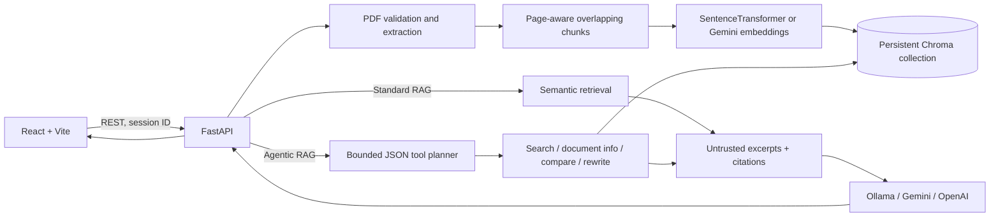

# RAG Document Assistant

A portfolio-focused PDF assistant that combines traditional retrieval-augmented
generation (RAG) with a bounded agent that can choose document tools. Upload and
manage multiple PDFs, ask grounded questions, inspect citations, and see which
tools the agent used.

## Key features

- Multi-PDF upload, duplicate detection, document listing, selection, and deletion.
- Page-aware PDF extraction, overlapping chunks, semantic embeddings, and persistent Chroma storage.
- Standard RAG mode plus Agentic RAG with search, document info, comparison, and one query rewrite.
- Ollama, Gemini, and OpenAI text-model providers; local SentenceTransformer or Gemini embeddings.
- Session-scoped follow-up context, source excerpts, citations, and inspectable agent activity.
- File-size/type validation, bounded agent steps, prompt-injection-aware prompts, and CORS allowlisting.
- Responsive React/Vite UI, FastAPI API, automated backend/browser checks, and Docker Compose.

## Architecture



The agent uses a small provider-neutral text-planning layer rather than LangGraph
or provider-specific function calling. It selects allowlisted tools, logs their
summaries, and stops after five iterations. Document excerpts are supplied to
answer generation as untrusted data, never as instructions. See
[ARCHITECTURE.md](./ARCHITECTURE.md) for the full design and trade-offs.

## Tech stack

- **Backend:** Python 3.13, FastAPI, Pydantic, PyPDF, ChromaDB, Ollama/OpenAI/Gemini SDKs.
- **Embeddings:** `all-MiniLM-L6-v2` locally, or Gemini `gemini-embedding-001`.
- **Frontend:** React 19, Vite 7, plain CSS, Playwright.
- **Storage:** Persistent Chroma index and uploaded PDFs under `backend/data/`.
- **Containers/CI:** Docker, Docker Compose, GitHub Actions.

## Local development

Prerequisites: Python 3.13, Node.js 22, npm, and either a running local Ollama
instance or credentials for a supported hosted provider.

### Backend

From the repository root in PowerShell:

```powershell
python -m venv .venv
.\.venv\Scripts\python.exe -m pip install -r backend/requirements-local.txt
Copy-Item backend\.env.example backend\.env
ollama pull llama3.2
ollama serve
```

In another terminal, run FastAPI:

```powershell
.\.venv\Scripts\python.exe -m uvicorn backend.main:app --reload --host 127.0.0.1 --port 8000
```

The initial local embedding request downloads `all-MiniLM-L6-v2`. Open
http://127.0.0.1:8000/docs for interactive API documentation.

For Gemini generation, set `LLM_PROVIDER=gemini` and `GEMINI_API_KEY` in
`backend/.env`. For OpenAI, set `LLM_PROVIDER=openai` and `OPENAI_API_KEY`.
Environment values are supplied when the process starts; embedding provider and
model settings are cached at backend startup, so restart and reindex after
changing them.

### Frontend

In a second terminal:

```powershell
Set-Location frontend
npm ci
npm run dev
```

Open http://127.0.0.1:5173. `VITE_API_URL` can override the API URL; it is
compiled into the browser bundle and must not contain credentials.

### Environment variables

Copy `backend/.env.example` to `backend/.env` and adjust as needed:

| Variable | Purpose | Default |
| --- | --- | --- |
| `LLM_PROVIDER` | Answer/planner model: `ollama`, `gemini`, or `openai` | `ollama` |
| `OLLAMA_MODEL` | Ollama model name | `llama3.2` |
| `OLLAMA_HOST` | Ollama API address | `http://127.0.0.1:11434` |
| `OPENAI_API_KEY` / `OPENAI_MODEL` | OpenAI credentials and model | Empty / `gpt-4.1-mini` |
| `GEMINI_API_KEY` / `GEMINI_MODEL` | Gemini credentials and model | Empty / `gemini-2.5-flash` |
| `EMBEDDING_PROVIDER` | `local` or `gemini` | `local` |
| `GEMINI_EMBEDDING_MODEL` | Gemini embedding model | `gemini-embedding-001` |
| `DATA_DIR` | Persistent PDFs and Chroma storage | `backend/data` |
| `MAX_UPLOAD_BYTES` | Per-file maximum upload size | `26214400` (25 MiB) |
| `FRONTEND_ORIGIN` | Optional additional allowed CORS origin | Empty |

Never commit `.env` files or place credentials in `VITE_*` variables. In Gemini
embedding mode, PDF text and questions are sent to the Gemini API. Changing the
embedding provider/model requires reindexing the documents.

## Docker

Docker Compose persists uploaded files and vectors in the `rag-data` named
volume. The backend container uses Gemini embeddings by default because the
production image intentionally excludes PyTorch/SentenceTransformers. Set
`GEMINI_API_KEY` and the model provider in `backend/.env`; run Ollama on the
host if using the default Ollama generation provider.

```powershell
Copy-Item backend\.env.example backend\.env
# Set GEMINI_API_KEY in backend\.env before starting.
docker compose build
docker compose up
```

The UI is at http://127.0.0.1:5173 and the backend at
http://127.0.0.1:8001. Docker Desktop provides `host.docker.internal` for
connecting the backend container to Ollama on the host. For a clean reset,
`docker compose down -v` removes the persistent document/vector volume.

## API

| Method | Endpoint | Purpose |
| --- | --- | --- |
| `POST` | `/upload` | Upload one PDF as `file`, or multiple PDFs as repeated `files` fields. |
| `GET` | `/documents` | List document IDs, names, page counts, chunk counts, and index times. |
| `DELETE` | `/documents/{document_id}` | Delete a PDF and all its vector records. |
| `POST` | `/ask` | Standard RAG. JSON includes `question`, optional `session_id`, and optional `document_ids`. |
| `POST` | `/agent/ask` | Agentic RAG with the same request fields and additional `agent` metadata. |
| `GET` | `/` | Health/message endpoint. |

Both question endpoints retain the `answer` and `sources` response fields. Each
source includes `document_id`, `filename`, 1-based `page`, and `text`; responses
also include the `session_id`. Agent responses add:

```json
{
  "agent": {
    "iterations": 2,
    "max_iterations": 5,
    "tools": [
      { "tool": "search_documents", "summary": "Retrieved 4 relevant passage(s).", "duration_ms": 14 }
    ]
  }
}
```

The agent can also call `get_document_info`, `compare_documents`, and
`rewrite_search_query`. A comparison is only answered when retrieved evidence
comes from at least two documents; a rewrite is limited to one retry. When
retrieval yields no evidence, the safe answer is `I don't know based on the
document.`

## Screenshots

No screenshots are committed yet. Add UI screenshots here when capturing a
portfolio/demo session.

## Tests and builds

From the repository root:

```powershell
.\.venv\Scripts\python.exe -m unittest backend.test_embeddings backend.test_workflow backend.test_agentic -v
Set-Location frontend
npm run build
npm run test:e2e
```

The backend tests mock models and embeddings, so they do not require paid API
calls, Ollama, or model downloads. The optional live backend test uses
`RAG_LIVE_TESTS=1`; the optional live browser test uses `RAG_BROWSER_LIVE=1`
and a running backend/Ollama. CI runs the offline tests, frontend build, and
container image builds.

## Known limitations

- Agent planning is JSON text planning, not native provider function calling;
  provider model responses may be malformed, in which case the planner safely
  falls back to retrieval.
- The agent has a five-step cap and only one rewrite. More advanced planning,
  parallel tools, and streaming are future improvements.
- Conversation memory is bounded and in process; it is not shared between
  server workers and is lost on restart. Run one backend worker for this MVP.
- Chroma and PDF files persist locally or in the Compose volume, but there is no
  authentication or per-user document isolation. Do not expose this service to
  untrusted networks without adding access control.
- Scanned/image-only PDFs need OCR. Context citations identify retrieved
  excerpts but are not sentence-level factual verification.
- Hosted embedding providers transmit input text to the provider. Ollama must
  be installed separately for local generation.
